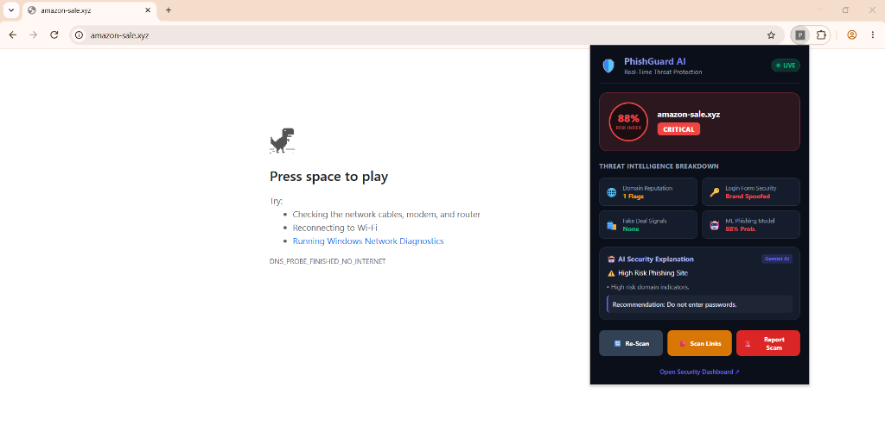

# 🛡️ PhishGuard AI - Real-Time Cybersecurity Browser Extension & Threat Intelligence System

[](LICENSE)
[](https://developer.chrome.com/docs/extensions/mv3/intro/)
[](https://nodejs.org/)
[](#features)

**PhishGuard AI** is an advanced, full-stack cybersecurity web protection platform designed to safeguard users against modern phishing attacks, credential harvesting traps, fake e-commerce clearance scams, and dangerous link downloads in real-time.

By combining **Browser Extension DOM Inspection (Manifest V3)**, **Domain Security Heuristics (Shannon Entropy & Brand Spoofing Engines)**, a **Machine Learning Phishing Classifier**, multi-vendor **Threat Intelligence (VirusTotal, Google Safe Browsing, PhishTank)**, and **Gemini AI Security Explanations**, PhishGuard provides actionable security intelligence before users submit passwords or payment details on untrusted sites.

---

## 📸 Live Extension Working Screenshot



---

## 🏗️ System Architecture

```
                                 ┌─────────────────────────┐
                                 │     User Browser Tab    │
                                 └────────────┬────────────┘
                                              │
                     ┌────────────────────────┴────────────────────────┐
                     ▼                                                 ▼
        ┌─────────────────────────┐                       ┌─────────────────────────┐
        │   Extension Popup UI    │                       │     Content Script      │
        │ (Security Badge, Risk   │                       │ (DOM Login Form Audit,  │
        │ Score, AI Explanation)  │                       │  Link Highlighting,     │
        └────────────┬────────────┘                       │  Fake Shop Detection)   │
                     │                                    └────────────┬────────────┘
                     └────────────────────────┬────────────────────────┘
                                              │
                                              ▼
                                 ┌─────────────────────────┐
                                 │  Background Service Wkr │
                                 └────────────┬────────────┘
                                              │  REST API calls
                                              ▼
                                 ┌─────────────────────────┐
                                 │   Express Backend API   │
                                 │      (Port 5000)        │
                                 └────────────┬────────────┘
                                              │
         ┌────────────────────────────────────┼────────────────────────────────────┐
         ▼                                    ▼                                    ▼
┌──────────────────┐               ┌──────────────────┐               ┌──────────────────┐
│ Domain Heuristic │               │   ML Phishing    │               │ Threat Intelligence│
│ & Typo Engine    │               │    Classifier    │               │ Engine (VT, Safe │
│ (Entropy, TLD)   │               │ (Feature Vector) │               │  Browsing, Phish)│
└──────────────────┘               └──────────────────┘               └──────────────────┘
                                              │
                                              ▼
                                   ┌─────────────────────┐
                                   │ AI Explanation Engine│
                                   │ (Detailed Risk Rsn) │
                                   └─────────────────────┘
```

---

## ✨ Key Features

### 1. 🔑 Phishing Login Trap Detector
- Detects login forms (`input[type="password"]`, `input[type="email"]`) targeting major brands (Facebook, Google, PayPal, Amazon, Netflix, Banks).
- Automatically triggers a security alert if brand credentials are being solicited on unauthorized or counterfeit domains.

### 2. 🛍️ Fake E-Commerce Store Scanner
- Identifies false 90% discount claims, artificial urgency timers, and unverified checkout payment forms commonly used on scam shopping frontends.

### 3. 🔴 Dangerous Link Highlighting
- Scans external links on any webpage on demand.
- Outlines suspicious external links in dashed red borders with 🔴 **Danger Badges** for links pointing to IP address hostnames, high-risk scam TLDs (`.xyz`, `.top`, `.click`), or executable file downloads (`.exe`, `.zip`).

### 4. 🤖 Gemini AI Security Explainer
- Translates raw technical security telemetry (entropy scores, TLD risk weights, vendor flags) into clear, plain-English explanations detailing *why* a site is safe or unsafe, along with actionable security advice.

### 5. 🤖 Machine Learning Phishing Classifier
- Extracts 10-feature vectors (URL length, symbol count, IP address flag, form presence, TLD weight) to calculate a normalized Phishing Probability index (0-100%).

### 6. 🌐 Threat Intelligence Command Center
- Standalone interactive Web Security Dashboard featuring a live **URL Sandbox Scanner**, real-time threat metrics, community scam reporting feeds, and active domain blacklists.

---

## 🛠️ Tech Stack

- **Frontend / Extension**: HTML5, Vanilla CSS3 (Glassmorphic Theme), JavaScript (ES6+), Chrome Extension APIs (Manifest V3 Service Workers, ActiveTab, Content Scripts).
- **Backend API**: Node.js, Native HTTP Server Engine, REST APIs, JSON Local DB Storage.
- **Security & ML Algorithms**: Shannon Entropy Algorithm, Brand Typosquatting / Leetspeak Detector, Decision Tree ML Classifier, Multi-source Threat Intelligence Integrator.

---

## 📂 Project Structure

```
browser-scam-detector/
├── assets/                             # Real working project screenshots
│   └── real_extension_screenshot.png  # Chrome Extension live working screenshot
│
├── extension/                          # Chrome Browser Extension (Manifest V3)
│   ├── manifest.json                   # Extension Manifest configuration
│   ├── popup.html                      # Glassmorphic Extension Popup UI
│   ├── popup.css                       # Dark mode theme styles
│   ├── popup.js                        # Extension frontend logic
│   ├── content.js                      # On-page DOM inspector & link highlighter
│   ├── content.css                     # On-page warning banners & danger link styles
│   └── background.js                   # Service worker tab monitor & badge manager
│
├── server/                             # Backend API & Security Analysis Engine
│   ├── server.js                       # REST API server entry point
│   ├── services/
│   │   ├── heuristics.js               # Domain entropy, TLD & brand typo engine
│   │   ├── ml_classifier.js            # 10-Feature Vector Machine Learning model
│   │   ├── threat_intelligence.js      # VirusTotal & Safe Browsing lookups
│   │   └── ai_explainer.js             # Gemini AI natural language explainer
│   └── db/
│       └── storage.js                  # Scan log persistence & blacklist DB
│
├── dashboard/                          # Web Threat Intelligence Dashboard
│   ├── index.html                      # Dashboard Web UI
│   ├── style.css                       # Dashboard styles
│   └── app.js                          # Dashboard API integrator
│
└── test-pages/                         # Demonstration Test Pages
    ├── fake-amazon-store.html          # Simulated clearance sale scam store
    ├── facebook-phishing-login.html    # Simulated credential phishing page
    └── legitimate-tech-blog.html       # Blog page for link scanner testing
```

---

## 🚀 Quick Start Guide

### 1. Clone the Repository
```bash
git clone https://github.com/sarthakjoshi-tech/phishguard-ai.git
cd phishguard-ai
```

### 2. Start the Backend API Server
```bash
cd server
node server.js
```
The API server will run on `http://localhost:5000`. You can verify API status at `http://localhost:5000/api/health`.

### 3. Load Extension in Chrome / Brave
1. Open Chrome/Brave and navigate to `chrome://extensions`.
2. Enable **Developer Mode** (toggle in top-right corner).
3. Click **Load unpacked** (top-left corner).
4. Select the `extension/` directory from this project.

### 4. Open the Web Threat Dashboard
Open `dashboard/index.html` in your web browser to test URLs in the interactive threat sandbox!

---

## 📄 License
This project is open-source and available under the [MIT License](LICENSE).
